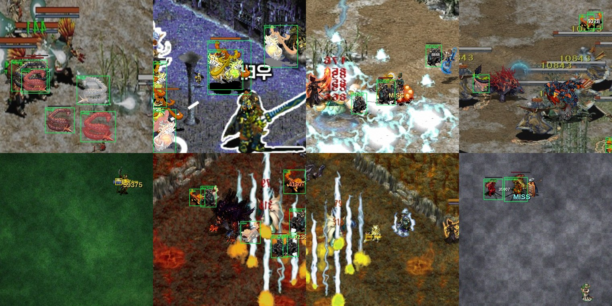
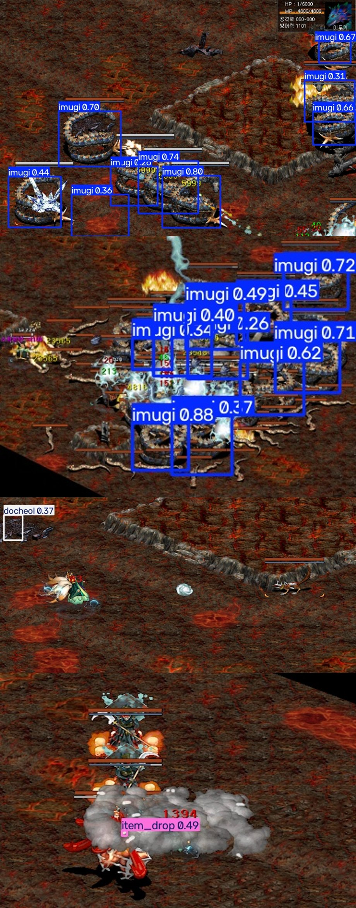

# 거상 YOLO 객체탐지 — 데이터셋 구축 & 실화면 검수 리포트

작성일: 2026-11-10 · 대상 저장소: `jhleee/gersang-db`

이 문서는 거상 인게임 **몬스터·드랍아이템 객체 탐지**를 위한
① 에셋 수집 → ② 합성 데이터셋 생성 → ③ Colab 학습 노트북 → ④ 실제 사냥 화면 검수
전 과정의 결과와 한계를 기록한다.

---

## 1. 결과 요약

| 항목 | 결과 |
|---|---|
| 학습 클래스 | 6종 (imugi·yeomra·docheol·nue·sammun·item_drop) |
| 합성 데이터셋 | **1,000장** (train 800 / val 200, 640×640), 라벨 **4,092개** (train 3,272 / val 820) |
| 에셋 | 몬스터 스프라이트 5종 + 아이템 아이콘 8종 + 하드 네거티브 146종 + 배경 148장 |
| 학습 파이프라인 | `notebooks/gersang_yolo_training.ipynb` (Colab 원클릭, T4 10~15분) |
| 기준 모델(이 저장소 동봉) | YOLOv8n, CPU 320px 21 epoch 미세조정 → 합성 val **mAP50 0.887 / mAP50-95 0.745** |
| 실사냥 화면 검수 | 이무기 화면 **검출 성공**(아래 §6), 염라대왕은 스킬 이펙트·사망 모션 프레임에서 미검출 |

> ⚠️ 이 리포트의 "실화면 검수"는 **사람 눈으로 확인한 근사치**다. 실제 사냥 화면에는 공개된 정답 라벨이 없어,
> 프레임별 검출 개수와 눈으로 센 개체 수를 대조했다. 정밀 mAP는 실사냥 프레임을 라벨링해야 나온다.

---

## 2. 수집한 에셋

| 구분 | 파일 | 출처 |
|---|---|---|
| 몬스터 스프라이트 | `assets/monsters/<class>/<key>.png` (RGBA) | GoGo-Lap 거상 몬스터 도감의 `characters/fullwait/*.webp` — 인게임 대기 스프라이트와 동일 이미지 |
| 드랍 아이템 | `assets/items/*.png` (60×60) | 같은 도감의 `items/*.webp` (유명계석·흉수의혼·환수의혼·엽전상자·보급상자·생명/심연의정수) |
| 하드 네거티브 | `assets/negatives/*.png` 146종 | 학습 대상이 **아닌** 다른 거상 몬스터 (오탐 억제용) |
| 배경 | `assets/backgrounds/*.jpg` 148장 | 실제 거상 사냥 화면 크롭 100장 + 지형 팔레트 절차적 텍스처 48장 |
| 검수 테스트 | `test_images/*` 13장 | 해해/문성/쀼뿝님 티스토리 공략글의 인게임 사냥 스크린샷(유명계 3층·얼음성·대둔산·귀곡성·소림사·챠우신전) |

`tools/collect_assets.py` 로 스프라이트·아이템·네거티브를 언제든 다시 받을 수 있고,
`tools/make_backgrounds.py` 가 스크린샷 크롭과 절차적 텍스처를 만든다.

수집기 검증 포인트
- 도감 카드 842~922개를 파싱해 **이름 → 스프라이트 경로** 매핑을 확보 (이무기 `python_100`, 염라대왕 `hellking_76`, 어린도철 `dochul3_100`, 누에 `nue_160`, 중독된삼문 `poisoninga_49`)
- 없는 이미지 요청 시 서버가 200 + HTML(2.5KB)을 돌려주므로 PIL 디코드 실패를 감지해 스킵하도록 처리

---

## 3. 합성 데이터셋 설계 (`tools/generate_yolo_dataset.py`)

실제 사냥 화면에서 관찰한 특징을 그대로 흉내내는 것이 핵심이다.

| 재현 요소 | 방법 |
|---|---|
| 스프라이트 표시 배율 | 클래스별 실측 배율(640 캔버스 기준). 이무기 0.72~1.05, **염라대왕 1.15~1.65**(보스라 크게 그려짐), 어린도철/누에/삼문 0.85~1.25, 아이템 0.35~0.62 |
| 도트 확대 | `NEAREST` 업스케일 + 큰 배율에서 약한 가우시안 |
| 몰이(무리) 배치 | 45% 확률로 기존 개체 옆에 군집 배치 → 실제처럼 겹쳐 쌓임 |
| 색 변형 | 스프라이트 hue ±45°, 장면 전체 hue ±35° (속성·조명 차이), 밝기/대비/채도 지터 |
| 전투 연출 | 발밑 그림자, 머리 위 HP 바, 피격 발광(흰/적), 데미지 숫자(MISS 포함) |
| 스킬 이펙트 | 연옥술류 화염·연기 반투명 오버레이(부분 가림) |
| 배경 열화 | 크롭·확대·반전·블러·노이즈·비네트·JPEG 72~94 |
| 하드 네거티브 | 학습 대상이 아닌 몬스터 1~4마리를 라벨 없이 배치 |

라벨 규칙
- YOLO 형식 `class_id x_center y_center width height` (0~1 정규화)
- 스프라이트의 **알파 마스크 실측 bbox**로 계산 → 좌표 오차 없음
- 가려짐이 심해 실제 보이는 픽셀이 35% 미만이거나, 캔버스 밖으로 55% 이상 잘린 개체는 **라벨에서 제외**(거짓 정답 방지)

클래스 분포 (seed 4242, 최종 배포본)

| 클래스 | train | val | 비고 |
|---|---|---|---|
| imugi (이무기) | 925 | 226 | 유명계 3층 주력 |
| yeomra (염라대왕) | 507 | 98 | 보스, 큰 스케일 |
| docheol (어린도철) | 436 | 139 | 대둔산 은신처 |
| nue (누에) | 448 | 114 | 일본 환수 |
| sammun (중독된삼문) | 549 | 144 | 검은상단 주둔지 |
| item_drop (드랍아이템) | 407 | 99 | 유석·혼·상자·정수 |
| **합계** | **3,272** | **820** | |



---

## 4. 학습

### 4-1. Colab (권장, 노트북)
`notebooks/gersang_yolo_training.ipynb` — 셀 7개 구성
1. `nvidia-smi` GPU 확인
2. `pip install ultralytics`
3. 저장소 클론 + 데이터셋 생성(또는 업로드한 zip 압축 해제) + `data.yaml` 경로 고정
4. `yolo detect train data=... model=yolov8n.pt epochs=50 imgsz=640 batch=16`
5. `yolo detect val` + `results.png`·`confusion_matrix.png`·검증 예측 이미지 표시
6. `test_images/` 실제 사냥 화면 추론
7. `best.pt` 다운로드 + ONNX 변환(`format=onnx imgsz=640 opset=12 simplify`)

### 4-2. 이 저장소에 동봉한 기준 모델
GPU가 없는 환경에서 파이프라인 자체를 검증하려고 CPU로 학습한 모델이다.
(`models/gersang_yolov8n_synth_baseline.pt`)

- 구성: YOLOv8n, imgsz 320, batch 4, CPU 2코어, 누적 21 epoch(15 → 6 → 6 미세조정)
- ONNX 변환 검증 완료: `models/gersang_yolov8n_synth_baseline.onnx` (imgsz 640, opset 12, simplify, fp32 12.8MB)
- 합성 val 200장 결과

| 지표 | 값 |
|---|---|
| Precision | 0.887 |
| Recall | 0.849 |
| mAP50 | 0.887 |
| mAP50-95 | 0.745 |

> 320px·CPU·21 epoch 조건이라 Colab에서 640px·50 epoch로 학습하면 이 수치는 크게 오른다.
> 참고로 더 쉬운 v3 데이터셋(군집 배치 이전)에서는 mAP50 **0.946**까지 나왔다.

---

## 5. 실제 사냥 화면 검수 (핵심)

`test_images/` 13장은 **학습에 전혀 쓰지 않은** 실제 인게임 화면이다.

### 5-1. 프레임별 검출 결과 (conf 0.25, imgsz 640)

| 이미지 | 화면 내용 | 검출 | 육안 판정 |
|---|---|---|---|
| `myeonggye3_imugi_01` | 유명계 3층, 이무기 흩어진 무리 | **imugi 9** | 실제 11마리 중 9마리 검출(≈82%), 박스 정확 |
| `myeonggye3_imugi_02` | 유명계 3층, 이무기 밀집 + 빙결 이펙트 | **imugi 3** | 15마리 이상 겹침 → 다수 누락(**가장 약한 케이스**) |
| `myeonggye3_imugi_03` | 유명계 3층, 밀집 무리 | **imugi 10** | 15마리 중 10마리(≈67%), 가장자리 누락 |
| `daedunsan_gi_01` | 대둔산 2층(기 사냥터) | docheol 1 | 실제 어린도철 없음 → **오탐** |
| `daedunsan_gi_02` | 대둔산 2층 | item_drop 2 | 오탐(바닥 텍스처) |
| `sorimsa_fight` | 소림사 전투 | docheol 2 | 오탐 |
| `icecastle_crab_01` | 얼음성 1층(얼음게) | item_drop 5 | 얼음게는 클래스에 없음 → 오탐 |
| `icecastle_crab_02` | 얼음성 1층 | 0 | 정상(대상 몬스터 없음) |
| `yeomrajon_01` | 염라존, 화면 전체 연옥술 | 0 | 몬스터가 이펙트에 완전히 가려진 프레임 — 판정 보류 |
| `yeomrajon_02` | 염라존, 염라 사망 모션 | 0 | 사망 잔해만 남은 프레임 — 검출 불가 |
| `yeomrajon_03` | 염라존, 사망 모션 | item_drop 1 | 위와 동일 |
| `chau_fight` / `gyegok_amakusa` | 챠우신전 / 귀곡성 | 0 | 대상 몬스터 없음 → 정상 |



### 5-2. 검수에서 확인된 것
1. **이무기는 실화면에서 바로 통한다.** 흩어진 무리에서는 0.7~0.95 신뢰도로 정확히 잡고, 박스도 스프라이트에 딱 붙는다.
   스프라이트가 인게임 그래픽과 동일하기 때문이다.
2. **밀집·이펙트 구간이 약점이다.** 몸이 겹치고 빙결/연옥 이펙트가 덮으면 신뢰도가 0.3대로 떨어지고 개체를 놓친다.
3. **염라대왕은 이번 프레임들로는 판정 불가.** 확보한 염라존 스크린샷이 전부 (a) 화면을 덮는 연옥술 연출, (b) 사망 잔해 장면이었다.
   살아 있는 염라 개체가 온전히 보이는 프레임을 추가로 확보해야 한다.
4. **오탐은 대부분 item_drop**이다. 바닥의 밝은 반점·이펙트 파편을 아이템으로 본다. 아이템 아이콘을 24~40px로 작게 배치한 합성과
   실제 드랍 아이템(발밑에 이름표와 함께 놓임)의 모양 차이가 원인이다.

---

## 6. 한계와 개선 로드맵

| 한계 | 원인 | 개선안 |
|---|---|---|
| 실화면 mAP 측정 불가 | 공개된 정답 라벨이 없음 | 실제 사냥 화면 100~200장을 CVAT/Roboflow로 라벨링 → 실사 val 셋 구축(가장 효과 큰 한 걸음) |
| 밀집 구간 재현율 저하 | 학습 320px, 겹침 시 라벨 제외 35% 규칙 | 640px 학습 + `copy-paste` 증강으로 겹침 샘플 강화, TTA/프레임 보팅 적용 |
| 염라대왕 검증 미완 | 온전한 개체 프레임 부족 | 유명계 3층 실사냥 영상에서 프레임 추출(30fps → 2초 간격) |
| item_drop 오탐 | 실제 드랍 연출 미반영 | 실제 드랍 아이템 스크린샷에서 아이콘+이름표 크롭 수집, 배경에 '가짜 드랍' 하드 네거티브 추가 |
| 다른 몬스터로 확장 | 클래스 6종 한정 | `assets/manifest.json` 의 842종 스프라이트를 그대로 쓸 수 있어 클래스만 늘리면 된다 |

---

## 7. 재현 방법

```bash
# 1) 에셋 수집 (스프라이트·아이템·네거티브)
python tools/collect_assets.py --out assets --negatives 150

# 2) 배경 패치 생성 (스크린샷 크롭 + 절차적 텍스처)
python tools/make_backgrounds.py --out assets/backgrounds --patches-per-shot 10

# 3) 합성 데이터셋 1,000장
python tools/generate_yolo_dataset.py --out datasets/gersang_yolo --images 1000 --preview 16

# 4) 학습 (GPU)
yolo detect train data=datasets/gersang_yolo/data.yaml model=yolov8n.pt epochs=50 imgsz=640 batch=16

# 5) 실제 사냥 화면 추론
yolo detect predict model=runs/detect/train/weights/best.pt source=test_images conf=0.25 save=True
```

---

## 8. 라이선스 · 출처

- 거상 게임 이미지(스프라이트·아이템 아이콘·스크린샷)의 권리는 **AK 인터랙티브 / 그라비티**에 있다.
  이 저장소의 에셋과 데이터셋은 **비상업적 연구·개인 학습 목적**으로만 모은 것이며, 재배포·상업적 이용을 허가하지 않는다.
- 스크린샷 출처: 해해(haehaegame.tistory.com), 문성(moon-seong.tistory.com), 쀼뿝(mhss.tistory.com) 공략글.
  원저작자 요청 시 즉시 해당 파일을 삭제한다.
